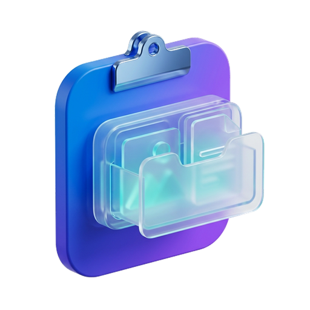

<p align="center">
  
</p>

<h1 align="center">ClipShelf</h1>

<p align="center">
  <b>Умный буфер обмена Windows 11 Fluent, плавающая полка файлов SuperHub и моментальная вставка Ctrl+V</b>
</p>

<p align="center">
  <a href="https://github.com/C0dece/PasteImageAsFile/releases/latest">
    
  </a>
  
  
  
  
</p>

---

## 🌟 Что такое ClipShelf?

**ClipShelf** — легковесная утилита продуктивности для Windows, объединяющая три ключевых сценария в едином интерфейсе Fluent Design:

1. 📋 **Продвинутый буфер обмена Windows 11 Fluent (Win+V)** — полноценная замена и прокачка системного буфера обмена с эффектом матового стекла (Acrylic Blur), историей текста, файлов, скриншотов, быстрыми заметками и поиском.
2. 🗂 **Плавающая полка файлов SuperHub** — экранная шторка для временного хранения и перетаскивания (Drag-and-Drop) файлов, картинок и ссылок между приложениями, мониторами и рабочими столами.
3. ⚡ **Smart File & Image Pasting** — мгновенная вставка скопированных картинок и фрагментов прямо в виде файлов через стандартный **Ctrl+V** в Проводнике или на Рабочем столе точно под курсор мыши.

---

## ✨ Ключевые возможности

### 📋 1. Буфер обмена Windows 11 Fluent
- **Глобальный хоткей `Win+V`**: перехватывает системный вызов с возможностью опционально отключить встроенный системный буфер Windows в один клик.
- **Эстетика Windows 11 Fluent**: настоящее акриловое размытие фона экрана (Acrylic Backdrop Blur), темная и светлая темы с автоматической синхронизацией с системой.
- **Вкладки и категории**: *Все*, *Снимки*, *Текст*, *Файлы*, *Заметки* и *SuperHub*.
- **Мгновенный поиск**: живая фильтрация карточек с векторным полем Fluent Search.
- **Без потери фокуса**: окно буфера открывается рядом с курсором без перехвата клавиатурного фокуса (`ShowWithoutActivation`), позволяя продолжать набор текста. Клик по карточке мгновенно вставляет элемент через `Ctrl+V`.
- **Создание заметок**: кнопка `[+ Заметка]` для быстрого сохранения сниппетов и мыслей прямо в буфер.
- **Кастомный темный скроллбар**: без белых системных полос и с плавной прокруткой.

### 🗂 2. Плавающая полка SuperHub
- **Двухцветный разделенный маркер**: компактный индикатор у края экрана (`138x5px`): верхняя половина открывает Буфер обмена, нижняя — полку SuperHub (настраивается в опциях).
- **Быстрый сбор `Ctrl+Alt+C`**: горячая клавиша для моментальной отправки текущего содержимого буфера или выделенных файлов на полку SuperHub.
- **Drag-and-Drop из любого источника**: бросайте файлы из Проводника, картинки из браузера (Edge, Chrome, Firefox), выделенный текст и веб-ссылки.
- **Папки и категории**: создавайте свои вкладки-папки прямо на полке SuperHub для организации задач и проектов.
- **Выгрузка в один жест `[📦]`**: кнопка пакетной выгрузки всех накопленных файлов одним движением перетаскивания.
- **Безопасность данных**: режим `[📋 Копия]` по умолчанию защищает оригинальные файлы от случайного перемещения или удаления.

### ⚡ 3. Моментальная вставка картинок как файлов (Ctrl+V)
- **Ctrl+V в Проводнике**: скопировал скриншот или веб-картинку — нажал Ctrl+V в любой папке — сразу получил файл `.png`.
- **Ctrl+V на Рабочем столе**: файл появляется строго под позицией курсора мыши.
- **Умное извлечение метаданных**: сохраняет оригинальные имена файлов из HTML-тегов `alt`, `title`, `data-src`, OpenGraph и заголовков веб-страниц.
- **Контекстное меню**: динамические пункты *"Вставить изображение (ClipShelf)"* и *"ClipShelf Буфер обмена"* в меню Проводника и Рабочего стола.

### 🔍 4. Окно детального просмотра (ItemViewer)
- **Быстрый предпросмотр `[👁]`** на любой карточке истории или полки.
- **Зум колесиком мыши** от 10% до 500% с центровкой на курсор и плавным панорамированием зажатой кнопкой мыши.
- **Булавка поверх окон `[📌]`**: закрепите карточку, скриншот или документ поверх всех окон для сверки данных.
- **Текстовый и документный ридер**: просмотр `.txt`, `.log`, `.cs`, `.json` с возможностью выделения и копирования, а также автоматическое извлечение чистого текста из `.docx` и `.doc` без внешних зависимостей.

---

## 🚀 Установка

1. Скачай **`ClipShelf.exe`** из раздела [Releases](https://github.com/C0dece/PasteImageAsFile/releases/latest).
2. Запусти файл — откроется окно управления и настроек.
3. Нажми **"Установить"** для регистрации автозапуска и контекстного меню.

Для тихой установки или скриптов:
```cmd
ClipShelf.exe --install
```

### Удаление из системы
В окне настроек нажми **"Удалить"** или выполни:
```cmd
ClipShelf.exe --uninstall
```

---

## ⌨️ Горячие клавиши по умолчанию

| Хоткей | Действие |
|---|---|
| `Win+V` | Открыть Fluent-буфер обмена рядом с курсором |
| `Ctrl+Alt+C` | Быстро отправить текущий буфер / файлы на полку SuperHub |
| `Esc` | Быстро закрыть всплывающее окно буфера или полки |
| `Ctrl+V` | Вставить скопированное изображение как `.png` файл в Проводнике |
| `Клик на маркер экрана` | Выдвинуть полку SuperHub или окно Буфера обмена |

---

## ⚙️ Параметры командной строки

| Параметр | Описание |
|---|---|
| *(без параметров)* | Открыть окно настроек ClipShelf |
| `--daemon` / `-d` | Фоновый режим работы (значок в трее и маркер экрана) |
| `--history` / `-v` | Вызвать Fluent-буфер обмена у курсора |
| `--superhub` / `--hub` | Выдвинуть плавающую полку SuperHub |
| `--install` / `-i` | Установить интеграцию в Windows |
| `--uninstall` / `-u` | Полностью удалить интеграцию и очистить реестр |
| `--save <путь>` / `-s` | Сохранить изображение из буфера в указанный каталог |

---

## 🛠 Сборка из исходников

Для сборки не требуются внешние пакеты или Visual Studio — достаточно стандартного компилятора .NET Framework, входящего в состав любой современной Windows:

```cmd
build.bat
```

Бинарный файл будет скомпилирован в `dist\ClipShelf.exe` (а также доступен как `dist\PasteImageAsFile.exe` для совместимости).

---

## 📄 Лицензия

Распространяется под свободной лицензией [MIT](LICENSE).
